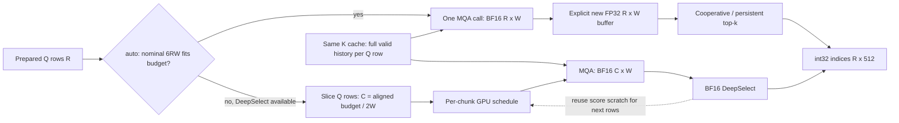

# Complete indexer pipeline and chunking measurements

**Version scope:** the complete historical matrix uses `cff6224872` native
kernels with an independent reproduction of PR64138's `4e5b4f8ce9` planner.
Its `PR 512` columns describe that policy on fixed historical kernels.
The final PR/new-main native kernels differ, so those columns are not an
unqualified timing claim for the final checkout. A separately labeled
`pipeline_newnative_*` cross-check uses the actual `4e5b4f8ce9` checkout and
its distinct native library, with matching inputs and explicit library hashes.

The older `553747b1df` prototype is covered by `prototype-1024`: unlike the
final PR it switches auto to DeepSelect even for small shapes. Source
comparison confirms that its entire `csrc`, vendored DeepGEMM and DeepGEMM
wrapper match the historical `cff6224872` checkout; its row helper also
reuses full metadata when one chunk suffices and rebuilds per-chunk metadata
otherwise. Thus this arm reproduces its row-budget/operator policy on the
same native kernels, without replacing the active checkout.

This experiment measures paged DeepGEMM logits followed immediately by top-k,
with production-format MXFP4 or FP8 Q/K caches, per-query context lengths,
request IDs, page tables, and BF16 head weights. Q/K projection is outside
this pipeline. All rows have head dimension 128 and top-k 512 unless the
record explicitly overrides it.

The score formula is `S[q,k] = sum_h w[q,h] * relu(dot(Q[q,h,:], K[k,:]))`.
There is no V input or attention softmax in this indexer step. The SM100
implementation converts ReLU dot products to BF16 before weighting, uses
four interleaved BF16 FMA accumulation lanes across heads, and combines them
with BF16 additions. It does not retain a full-precision score until a final
BF16 cast. The later FP32 buffer cannot recover those rounded bits.

An independent CPU reference unpacks E2M1 nibbles/FP8 values from the planar
cache and reproduces that native BF16 reduction. All 18 model-shape ×
precision × q={1,3,8} cases (432 sampled scores) matched the GPU bitwise.
Compared with an ideal FP32 head reduction, relative L2 differences ranged
from 0.25% to 0.78%; those are existing kernel arithmetic, not a chunking
error. Raw checks are in `results/pipeline_math_reference.jsonl`.

The candidate fallback mask uses 2048 output slots containing the first valid
candidate blocks, padded with -1 for short rows. This deterministic mask is a
kernel-cost proxy, not a saved model candidate distribution. Candidate block
production uses the actual block-score reduction and DeepSelect, including
the forced newest block; its selected-score multiset is also checked.

Both cache formats use two physical regions inside each page: all token
values first, then all token scales. Inputs follow the production compressor
writer and `tests/kernels/attention/test_deepgemm_attention.py`. FP4 values
use finite E2M1 nibbles and unit UE8M0 scales; FP8 values are converted finite
normal samples with unit scales. An initial probe incorrectly interleaved
FP4 values/scales per token and failed the NaN/correctness gate; those error
records are retained in `pipeline_probe.jsonl` and contain no accepted timing.
Old scripts that fill the complete cache with arbitrary random bytes can
produce NaN or extreme scales, so their timings are not the controlled-input
baseline for this experiment.

| Model shape | Heads | Logits capacity | Compression |
| --- | ---: | ---: | ---: |
| V4 | 64 | 262144 | 4 |
| V4.1 dense c2 | 32 | 524288 | 2 |
| V4.1 dense c1 | 32 | 1048576 | 1 |

On this SM100 path both FP8 and MXFP4 Q/K produce BF16 logits, so changing
the Q/K quantization does not change these row-budget thresholds. Heads and
Q/K precision affect the scoring cost and input/cache size; logits capacity
and the selector's need for an FP32 copy determine the planner's score-buffer
bytes per row.

`context_tokens` is the uncompressed request context; each speculative group
contains up to eight Q rows whose effective compressed lengths increase
according to the compression ratio. Capacity remains fixed when actual
context is short. The scalar top-k maximum defaults to the configured
capture bound; `--max-seq-mode actual` is a separate experiment.

`R` here is the tensor's decode-query row count, with all benchmark rows
active. The PR plans using `num_padded_tokens`; in a FULL replay its branch
and chunks belong to the selected capture bucket. Active rows mapped to a
larger bucket inherit that bucket's backend, rather than re-running Python
selection using the active request count. PIECEWISE/eager decode rows must
also be distinguished from padded hidden-state rows and prefill rows.

The independent variants are:

| Variant | Selection and scheduling |
| --- | --- |
| single-auto | One BF16 logits allocation, FP32 conversion, current auto dispatcher. Reuses full prebuilt metadata. |
| single-ds | One BF16 logits allocation, DeepSelect, full prebuilt metadata. |
| final-512 | PR 64138: preserve auto when capacity × rows × 6 bytes fits 512 MiB; otherwise DeepSelect and 16-row-aligned chunks sized using 2 bytes per score. |
| prototype-1024 | Original experiment's DeepSelect with 1 GiB row chunks. |
| auto-512 | Retain auto and BF16→FP32 while chunking using 6 bytes per score. |
| ds-256/512/1024/2048 | Fixed DeepSelect with the named MiB budget. |
| prebuilt-512 | Same DeepSelect row chunks as ds-512, but prebuild each chunk's metadata outside the timed region. |

For 512 MiB and the three capacities, C is1024/512/256 respectively.
FULL captures the GPU operations and their buffer addresses; its Python
partition/backend decision runs during capture. Replays recompute scores
from the current Q/K/length buffers. PIECEWISE/eager still computes the same
indexer work and also repeats the host chunk loop. Candidate operations,
when present, sit between score production/conversion and final top-k.

For multi-chunk product-like paths, each chunk rebuilds its own metadata in
the measured pipeline. Chunking splits Q rows only; each row still scores its
entire valid K context. Logits are consumed before the next chunk is produced.

Correctness is checked before timing: valid chunked logits versus a single
DeepGEMM call, index bounds and duplicates, and the multiset of selected
scores versus `torch.topk`. Index-set differences from equal scores are
reported separately. The sampled legacy kernel has exact threshold/fallback
guards; sampling does not mean approximate selected values. Any selected-value
mismatch fails the correctness gate before timing and remains a diagnostic
record. In particular, an overflowing legacy pointer must not be described
as a permitted approximation.

Exact selected scores allow different indices at BF16 ties. These kernel
checks therefore do not establish identical model tokens or evaluation
accuracy; checkpoint-level evaluation remains a separate requirement.

Timing uses CUPTI with separately captured whole-pipeline graphs, warm and
cold L2 trials. FlashInfer's helper returns the interval from the earliest
kernel start to the latest kernel end for each replay, rather than summing
kernel durations. Optional isolated-stage CUPTI timings measure prebuilt
metadata, logits, upcast, and top-k using fixed inputs and warm L2; their sum
is not a substitute for the whole-pipeline time. Separate PyTorch CUDA
profiling records the kernel names/counts/times inside replay. Eager host
submission and synchronized wall time are measured separately.

Graph memory is measured in a fresh private graph pool after compilation.
`peak_extra_bytes` is allocator peak above allocations live after warmup
(inputs, outputs, and any backend persistent workspace), while
`live_extra_bytes` and `reserved_extra_bytes` describe the retained pool.
Observed BF16 row strides are 262656, 525312, and 1049088 elements for
256K, 512K, and 1M capacities. Padding and allocator block rounding make
the nominal 512 MiB chunk about 514 MiB for V4/c2 and 512.25 MiB for c1.
This is allocation size, distinct from bytes actually
read or written for valid positions.

Raw records are appended and flushed after every variant. `--resume` skips
successful case/variant keys. Errors retain the full traceback. Results and
analysis will be added after the probes and scan complete.

These manually captured complete pipelines compare GPU costs independently
of vLLM's capture-grid policy. In PR 2's default configuration, decode capture
is bounded by 4096 tokens, so an 8192-row step can take PIECEWISE/eager rather
than the manually measured FULL graph. The eager measurements are therefore
essential for that case. This benchmark does not establish which graph mode
the model runner selects at runtime.

V4.1 step estimates must combine three c2 dense source layers (2, 8, 14) and
one c1 candidate-producing layer (20). The latter includes candidate block
selection, measured separately from the `candidate=none` c1 ablation. With
sparse logits enabled the remaining four source layers use compact candidate
logits and are outside this dense-path modification. Historical candidate-
disabled fallback can instead have four additional c1 masked layers. Do not
multiply every layer by the same width or interpret any one row of this
benchmark as a complete model step.

Prebuilding chunk metadata isolates its cost. It is not a production
recommendation without designing how the buffers update as context lengths
change. Likewise, isolated warm-stage times cannot simply be added to predict
the complete pipeline: repeatedly timing one small chunk can keep its K data
in L2, while the whole replay visits all requests' K pages. Chunk boundaries
here preserve eight-query request groups, so loss of within-request K reuse
should not be claimed without further evidence.

For work normalization, each case records `valid_elements=sum(seq_lens)`.
The QK dot products perform approximately `2 * valid_elements * heads * 128`
FLOPs, followed by ReLU/head weighting/reduction. Score-buffer minimum
traffic is approximately `4 * valid_elements` bytes for BF16 production plus
one BF16 selection read, versus `12 * valid_elements` for BF16 production,
BF16→FP32 conversion, and one FP32 selection read. These exclude repeated
selection passes, Q/K traffic, padding allocations, and candidate operations.
They are minimum traffic estimates, not measured HBM bandwidth. A complete
pipeline is mixed compute and memory work; valid scores per second is a
safer cross-context throughput metric than dividing its allocation capacity
by time.

The V4/1536-raw-context case has only about 384 compressed K positions, below
top-k 512. Old selectors have a trivial `seq_len <= TopK` index-fill path,
so this case does not exercise the usual selection scan. Read-traffic
estimates that assume a selection pass do not apply to such short rows.
V4.1 c2/c1 at the same raw context have about 768/1536 valid positions and
therefore still perform selection.

Eager wall samples synchronize before each isolated indexer call. In a full
model, host submission work can overlap Transformer kernels already queued
on the GPU. Multiplying these isolated wall times by the layer count does
not predict end-to-end model latency; it estimates exposed indexer costs.
Model forward/serving measurements are needed to determine the actual step
or throughput regression.

The core and pinned eager recheck intentionally retain the capture-bound
scalar (`max_seq_len=1M`) while changing execution mode, isolating the CPU
chunk loop with a fixed GPU path. Production PIECEWISE/eager instead passes
the raw actual context maximum. `pipeline_actual_bound.jsonl` measures that
separate condition; capture-bound eager timings alone are not an exact
reproduction of the production selector branch.

## Core results

Completed: 162 shapes × 10 variants = 1620 accepted measurements, each with
100 replays × 3 trials for both warm and cold L2. All valid chunked logits
matched the single call bitwise; DeepSelect selected-score multisets matched
the exact reference. Final inter-trial CV was at most 3% for every arm.
The 60 cases retaining the same auto GPU path nevertheless varied by about
−3.5% to +5.0% across separately captured arms. Treat changes within 5% as
inconclusive unless the controlled recheck supports them.

The real-model MRV2 baseline probes in [MEMORY.md](MEMORY.md) already account
for large eager-break allocations during graph profiling. Their default-.90
stress completed without OOM, with allocator retries. Thus this operator
experiment proves a reduction in temporary allocations and its performance
costs; it does not establish that the observed baseline configuration OOMs.

Of the 162 shape cases, 60 preserve auto, 30 switch to single-call DeepSelect,
and 72 use multiple DeepSelect chunks. Every single-call switch improved GPU
latency by 20–37%. Among the multi-chunk cases, 39 regressed by over 5%, 18
improved by over 5%, and 15 stayed within 5%. This change reduces temporary
allocations with shape-dependent performance.

Representative MXFP4 results at R4096, q8, top-k512, warm-L2 complete graph
span (microseconds). Capacity is fixed at the model shape's maximum; context
is the raw uncompressed token count. These rows omit candidate operations.

| Shape | Raw context | Old auto | PR 512 | Change | Chunks | Peak old/PR MiB |
| --- | ---: | ---: | ---: | ---: | ---: | ---: |
| V4 | 1536 | 43.82 | 58.75 | +34.1% | 4 | 6156.00 / 514.00 |
| V4 | 8192 | 160.59 | 157.92 | −1.7% | 4 | 6156.00 / 514.00 |
| V4 | 32768 | 328.91 | 289.28 | −12.1% | 4 | 6156.00 / 514.00 |
| V4.1 c2 | 1536 | 93.50 | 132.36 | +41.6% | 8 | 12312.00 / 514.00 |
| V4.1 c2 | 8192 | 170.24 | 217.44 | +27.7% | 8 | 12312.00 / 514.00 |
| V4.1 c2 | 32768 | 435.94 | 396.19 | −9.1% | 8 | 12312.00 / 514.00 |
| V4.1 c1 | 1536 | 114.50 | 219.38 | +91.6% | 16 | 24588.00 / 512.25 |
| V4.1 c1 | 8192 | 266.49 | 392.32 | +47.2% | 16 | 24588.00 / 512.25 |
| V4.1 c1 | 32768 | 760.68 | 736.16 | −3.2% | 16 | 24588.00 / 512.25 |

The wider V4.1 c1 shape is the strongest short-context regression: at R8192,
1536 raw context tokens, MXFP4 auto takes 222.40 us versus 515.28 us for the
32-chunk PR path (+132%), while peak allocation falls from 49176 MiB to
512.25 MiB. At 32768 raw context tokens the same GPU comparison is essentially
flat (1470.70 versus 1469.25 us). Unbound core eager samples show substantial
host costs; the separate pinned 30-sample recheck is used below to assess
their stable magnitude.

Budget/metadata ablation at R8192, raw context8192, q8. All numbers are warm
graph microseconds. `Prebuilt` uses the 512 MiB row chunks and excludes their
metadata updates; it is an attribution control, not a deployable proposal.

| Shape | Precision | Auto | Single DS | DS 256 | DS 512 | DS 1024 | DS 2048 | Prebuilt 512 |
| --- | --- | ---: | ---: | ---: | ---: | ---: | ---: | ---: |
| V4 | MXFP4 | 303.23 | 204.93 | 464.54 | 329.30 | 257.90 | 228.83 | 299.90 |
| V4 | FP8 | 334.02 | 233.20 | 472.58 | 344.76 | 281.22 | 258.86 | 314.18 |
| V4.1 c2 | MXFP4 | 331.87 | 204.48 | 650.75 | 434.39 | 320.13 | 252.07 | 374.94 |
| V4.1 c2 | FP8 | 376.54 | 250.83 | 691.11 | 478.43 | 363.36 | 302.05 | 414.70 |
| V4.1 c1 | MXFP4 | 506.78 | 314.90 | 1272.40 | 784.66 | 566.40 | 435.76 | 670.64 |
| V4.1 c1 | FP8 | 604.64 | 413.57 | 1349.13 | 861.31 | 649.47 | 543.26 | 744.00 |

Independent kernel profiling of the V4.1-c1/MXFP4/R8192/context8192 case:

| Arm | Metadata calls/time | MQA calls/time | Upcast | Top-k calls/time |
| --- | ---: | ---: | ---: | ---: |
| Old auto | prebuilt | 1 / 183.2 us | 81.0 us | 1 sampled / 245.2 us |
| Single DS | prebuilt | 1 / 181.8 us | none | 1 DS / 130.1 us |
| PR 512 | 32 / 126.8 us | 32 / 430.6 us | none | 32 DS / 187.9 us |

The MQA kernel has the same compiled template specialization in all three
arms. Repeating smaller calls increases its accumulated cost, and per-chunk
metadata adds further work; both can outweigh the faster selector and removed
upcast. These profiler times are a separate run from the CUPTI spans, so their
sums are not expected to match the headline spans exactly.

Here `sampled` names the launched wrapper. Its GPU-side length check sends
these 8192-position rows to `filtered_topk_row`; the sampling branch starts
only at 98304 positions for k512. The wrapper's 64-bit row pointer is still
materially different from the direct filtered launch selected by a short
host bound. A kernel name alone does not establish which internal path ran.

`pipeline_summary.py` prints the full R8192 precision/context table and the
budget table from immutable `results/pipeline_core_*.jsonl` files. Across
292770 rows in the single-auto references, no selected-value mismatch was
observed for these synthetic quantized scores; 187 rows differed from
`torch.topk` in index set because of ties. This observation does not prove
output identity on checkpoint logits or at other shapes.

## Controlled host-submission recheck

All 324 large-row recheck variants passed correctness with CPU affinity
32–39 and 30 eager samples. One FP8 single-DS warm GPU point retained CV>3%
after three retries and is explicitly marked noisy. GPU2 context-startup
overlap windows are retained in `results/pipeline_events.jsonl`; the rows
below use the unaffected 8192-raw-context MXFP4 cases.

These remain **capture-bound eager** comparisons (`max_seq_len=1M`), used
to hold the selector path fixed while exposing the Python/C++ submission
cost. They are isolated calls, not model step times or production-actual-bound
selector timings.

| Shape | Rows | Old eager wall us | PR eager wall us | PR host-only us |
| --- | ---: | ---: | ---: | ---: |
| V4 | 4096 | 303.3 | 827.4 | 795.3 |
| V4.1 c2 | 4096 | 316.7 | 1522.0 | 1470.8 |
| V4.1 c1 | 4096 | 374.4 | 2964.5 | 2891.5 |
| V4 | 8192 | 399.7 | 1525.2 | 1490.3 |
| V4.1 c2 | 8192 | 433.6 | 2932.5 | 2881.4 |
| V4.1 c1 | 8192 | 614.8 | 5612.2 | 5541.8 |

The host cost scales with the number of chunk calls. Large row counts do
not make the Python/C++ submission cost disappear. FULL replay removes that
repeated submission, while retaining GPU work from all chunk kernels.

## Candidate-path results

Completed 64 candidate-source and 64 dense-mask variants, with exact selected
token values. The source cases also checked candidate-block bounds,
uniqueness, the forced newest block, and selected block-score multisets.

V4.1 c1, MXFP4, R4096, raw context8192, warm graph microseconds:

| Candidate operation | Old auto | Single BF16 DS | PR 512 | DS 1024 MiB | PR peak MiB |
| --- | ---: | ---: | ---: | ---: | ---: |
| Produce blocks | 368.18 | 259.54 | 534.38 | 396.99 | 576.252 |
| Dense mask fallback | 4758.14 | 5432.71 | 5609.67 | 5541.29 | 544.252 |

The old peak in both rows is 24588 MiB. Source block scores add about 64 MiB
to a 256-row BF16 chunk; dense-mask flags add about 32 MiB. A 512 MiB logits
budget therefore does not promise a 512 MiB total indexer peak.

Dense masking writes the complete capacity, including invalid tails, unlike
the valid-prefix logits/upcast work. In this implementation BF16 masking is
not faster simply because it writes fewer useful bytes. Generated PTX/SASS
shows eight scalar 16-bit stores per thread for BF16 and eight scalar 32-bit
stores for FP32, with 17/22 registers and no spills/shared memory. At this
shape the mask launches 4096×1024 CTAs. The code-generation audit is retained
in `pipeline_mask_codegen.txt`; it does not establish which instruction,
dispatch, or memory-transaction effect dominates. Latest sparse-logits
consumers avoid this dense-mask fallback, so this row must be kept separate
from their compact-logits path.

## Query grouping and launch geometry

An additional 480 variants covered q={1,2,3,4,6}, V4/c1, both precisions,
R={64,256,1024,4096}, and raw context8192/32768. All valid chunked scores
were bitwise equal to the unchunked call and all selected values were exact.
In particular, 16-row boundaries can split q3 requests, and that remains
correct. Alignment does not imply every request group stays intact.
Changing q at fixed R changes request count and K-cache reuse, so it can
change MQA performance despite identical score-buffer allocation sizes.

Five-replay CUPTI launch-configuration traces for c1/R8192/context8192 were
collected on GPU3 as a configuration probe, separately from GPU1 timings:

| Kernel | Whole-call grid/block | PR chunk grid/block | Registers/thread | Dynamic shared bytes |
| --- | --- | --- | ---: | ---: |
| MQA | 152 / 512 | 152 / 512, repeated32 | 128 | 227328 |
| DeepSelect | 8192 / 256 | 256 / 256, repeated32 | 95 | 109568 |
| Chunk metadata | prebuilt | 1 / 256, repeated32 | 39 | 2084 |
| Upcast | 8192 / 128 | absent | 24 | 2048 |
| Old sampled wrapper | 8192 / 1024 | absent | 64 | 131072 + 5632 static |

Device limits are 152 SMs, 233472 shared bytes, 65536 registers and 2048
threads per SM. MQA's resource use permits at most one such CTA per SM.
Its grid does **not** shrink under row chunking: the same persistent grid
restarts on less work 32 times. DeepSelect's resource-only CTA upper bound
is two per SM at this configuration; actual occupancy was not measured.
Small-row DeepSelect can choose a different configuration, so these numbers
must not be generalized to R1/R8. Raw traces and limits are in
`pipeline_launch_details_gpu3.jsonl` and `pipeline_device_attrs.jsonl`.

The 1 Hz clock/power trace observed stock-power capping during a heavy
q1/c1/FP8/R4096/context32768 stage: 915 MHz, 1182.6 W against a 1200 W limit,
with the software-power-cap flag active and no thermal-throttle flag. Those
measurements describe stock adaptive-clock operation, not locked-clock
kernel throughput. The trace is `pipeline_telemetry.log`.

## Actual-bound legacy correctness failure

The R≤4096 actual-raw-bound grid has 318 accepted variants and six rejected
legacy baselines. All six are c1/R4096 single-auto, both precisions, at raw
contexts1536/8192/32768. Each has exactly one selected-value error despite
valid bounds, counts and uniqueness, and bitwise-correct MQA scores. These
arms failed before timing and are excluded from performance comparisons.

The direct filtered kernel computes its row offset from two uint32 operands.
At stride1049088 the first overflowing row is4095. The separate top-k
worker's fully initialized structured diagnostic shows that row's selection
matches the wrapped-address reference 512/512 and the correct-row reference
0/512. The capture-bound sampled wrapper uses a 64-bit stride and produces
the correct row. This is an address calculation defect, not an allowed
approximation or a BF16 rounding difference. See
`results/topk_u32_diagnostic.jsonl` and `pipeline_actual_bound.jsonl`.

The PR's default small row chunks avoid that local offset overflow, but the
integer-indexing defect needs its own source fix and regression coverage.
No product source was modified by this experiment.

The R8192 extension adds 42 accepted and 12 rejected variants. At c2's
stride525312, all six old-auto cases have 15 wrong-value rows, starting at
row8177; at c1's stride1049088, all six have 4097 wrong-value rows, starting
at4095. V4's smaller stride stays below the overflow boundary at R8192.
All DS and default PR-chunked cases pass. This matches the physical-stride
overflow calculation and also shows why invalid old baselines must be
excluded before a performance winner is selected.

## Final-PR native cross-check

The independent `4e5b4f8ce9` checkout and native library were also measured
on GPU3, with the same production-format inputs. For `final-512`, this run
calls that checkout's actual planner; changed paths call its
`_varlen_decode_rows` helper, and unchanged paths retain the baseline call.
The baseline and single-DeepSelect arms use the same final native library,
so each comparison below is within one process/device/source version.
The matrix covers 270 cases: three capacities, both Q/K precisions,
R={64,256,1024,4096,8192}, three contexts and three paths. All accepted
variants passed exact selected-value and bitwise chunked-logit checks.

| Capacity / heads | Raw context | Old auto | Single DS | PR 512 | PR GPU change |
| --- | ---: | ---: | ---: | ---: | ---: |
| V4 256K / 64 | 1536 | 78.14 | 51.20 | 121.44 | +55.4% |
| V4 256K / 64 | 8192 | 293.95 | 203.04 | 330.56 | +12.5% |
| V4 256K / 64 | 32768 | 621.82 | 441.15 | 584.13 | -6.1% |
| V4.1 c2 512K / 32 | 1536 | 181.06 | 107.81 | 275.18 | +52.0% |
| V4.1 c2 512K / 32 | 8192 | 326.40 | 207.20 | 440.88 | +35.1% |
| V4.1 c2 512K / 32 | 32768 | 831.71 | 528.98 | 795.75 | -4.3% |
| V4.1 c1 1M / 32 | 1536 | 213.60 | 132.40 | 517.44 | +142.2% |
| V4.1 c1 1M / 32 | 8192 | 500.61 | 320.66 | 787.54 | +57.3% |
| V4.1 c1 1M / 32 | 32768 | 1477.23 | 937.79 | 1492.95 | +1.1% |

Units are microseconds for R8192, MXFP4 Q/K, warm-L2, whole-pipeline CUDA
graph timing. This is a manually captured GPU-cost comparison; R8192 is
above PR-2's default 4096-token FULL capture limit and need not actually
dispatch to FULL. It does not measure a model's decode-step latency or
serving throughput. Input values are synthetic quantized Q/K, not saved
checkpoint activations. The matching FP8 matrix, graph memory, standalone
eager timings and kernel names are in `pipeline_newnative_core.jsonl`.

These results confirm that the chunking penalty and the difference between
V4's 1024-row chunks and c1's 256-row chunks survive the native-version
cross-check. In particular, removing the FP32 conversion alone improves
these cases, while splitting the same scoring work can lose more time than
that conversion saved. Changes around a few percent remain sensitive to
stock clocks and cache behavior; they are not a general throughput claim.

The final-native candidate-producer cross-check has 24/24 accepted variants.
Its separate actual-bound c1/R4096 grid has 12 accepted DS/chunked variants
and six rejected old-auto variants. Both Q/K precisions and all three actual
contexts reproduce one selected-value-error row with stride1049088. Thus
the direct-filtered address defect also reproduces dynamically with the
final PR library; rejected variants contain correctness evidence but no
timings. The original structured wrapped-address proof remains a historical
native diagnostic, and is not mislabeled as a second final-native proof.

The final-native run also uses stock adaptive clocks. Its 1 Hz trace includes
software power capping in nine samples and lows down to 1095 MHz in accepted
case windows. These windows include correctness, profiling and warmup as
well as timing, so the trace does not identify the instantaneous clock of
each CUPTI sample. Per-case associations and the full trace are preserved
in `pipeline_newnative_power_case_summary.jsonl` and
`pipeline_newnative_telemetry.jsonl`. Passing inter-trial CV does not prove
fixed-frequency operation.

## Longer-context and budget checks

The historical-native 128K raw-context matrix adds 144 accepted variants;
the full 1M raw-context matrix adds 108 variants with R≤1024. These exercise
substantially more valid K work than the short-context grid while keeping
the same capacity-based planner. Representative MXFP4 whole-pipeline warm
graph times are:

| Capacity | Rows | Raw context | Old auto | Single DS | PR 512 |
| --- | ---: | ---: | ---: | ---: | ---: |
| V4 256K | 4096 | 131072 | 993.18 | 712.99 | 800.99 |
| V4.1 c2 512K | 4096 | 131072 | 1631.70 | 851.62 | 1055.12 |
| V4.1 c1 1M | 4096 | 131072 | 2670.59 | 1596.08 | 1932.80 |
| V4 256K | 1024 | 1048576 | 1737.78 | 1259.04 | 1264.64 |
| V4.1 c2 512K | 1024 | 1048576 | 2407.87 | 1571.11 | 1637.28 |
| V4.1 c1 1M | 1024 | 1048576 | 5531.97 | 3281.49 | 3265.19 |

Times are microseconds. At longer contexts the selector/conversion savings
can dominate the chunk overhead, so a short-context slowdown cannot be
generalized to all context lengths. Nor does a long-context improvement
justify a universal DeepSelect or chunk-size dispatch rule.

An additional 378 FP32-path variants compare auto at 256/1024/2048 MiB and
explicit persistent at 256/512/1024/2048 MiB. They all passed correctness.
Keeping FP32 while reducing the budget can create many more chunks, and
backend names do not identify a single fixed CUDA kernel: a 32-row forced
persistent chunk can use the generic radix implementation, while larger
chunks dispatch elsewhere. For c1/R8192/raw1536, the 256 MiB forced
persistent path uses 256 chunks and approximately 12.66 ms, versus about
0.515 ms for PR's 32 BF16 chunks. Preserving FP32 is not a free alternative
to changing the top-k implementation.

`pipeline_policy_frontier.jsonl` contains 972 **derived policy mappings**,
each linked to an equivalent already measured backend/chunk sequence. They
are not additional GPU measurements. Raising the current coupled budget
also expands the region that preserves FP32: for example V4/R1024 switches
from single DeepSelect at 512 MiB back to old auto at 2048 MiB. Consequently
"larger chunks are faster" does not imply "raising this environment variable
is always faster."

A separately labeled, unimplemented counterfactual retains the 512 MiB
backend-switch threshold while allowing 1024/2048 MiB DS chunks. In this
historical grid, 72/162 cases improve by more than 5% and 90 keep the same
operator sequence; none regress by more than 5%. This is a local operator
trade-off that spends more transient memory. It does not account for a
changed global KV reservation or prove model/serving gains, and no such
production policy was implemented here.

## Controlled repeats and completion

The final historical-native recheck keeps three independently captured
private graph pools alive and randomizes A/B/C × warm/cold order in each
of five trials. Each trial contains 100 CUPTI-measured replays. This avoids
attributing a systematic earlier/later run order to a backend. All four
R8192/MXFP4 cases pass in the first round, with maximum inter-trial CV below
0.27% across both cache modes:

| Capacity | Raw context | Old auto | Single DS | PR 512 |
| --- | ---: | ---: | ---: | ---: |
| V4 256K | 8192 | 302.99 | 203.94 | 320.32 |
| V4 256K | 32768 | 624.16 | 431.87 | 564.50 |
| V4.1 c1 1M | 8192 | 504.42 | 311.78 | 741.49 |
| V4.1 c1 1M | 32768 | 1465.83 | 923.71 | 1435.86 |

Units are warm-L2 GPU microseconds. The dominant c1 short-context penalty
and V4 long-context improvement remain. Few-percent differences between
separate runs should be treated as broadly similar, even when individual
trials have low variance.

The additional pinned-CPU eager recheck has 48/48 correct and stable GPU
variants. A three-arm repeat of the previously noisy c1/FP8/R4096/raw32768
case uses five trials ×300 replays, and all final warm/cold CVs pass 3%.
The original noisy observation is retained rather than replaced. Both
rechecks add ten eager warmups before their 30 host/wall samples; the core
eager protocol is preserved separately. These remain standalone indexer
wall times and do not establish whole-model host overhead.

All pipeline GPU work completed at approximately11:50 UTC on October28.
GPU1/GPU3 runners and monitors exited and the devices were released to the
other worker. The final audit parses every raw JSONL, checks all accepted
score/value/bounds/candidate gates and confirms that no rejected variant
contains performance timings. It reports zero audit failures. There are
30 retained rejections: six initial malformed-cache probes, six historical
R4096 actual-bound legacy cases, twelve R8192 actual-bound legacy cases,
and six final-native R4096 actual-bound legacy cases.

`results/pipeline_audit.jsonl` includes per-file counts and SHA256 hashes.
The historical NVML trace has 5308 one-second samples, 163 with software
power capping; it covers the later auxiliary period rather than every core
case. The final-native trace has 609 samples and nine power-capped samples.
No clocks were locked. Ruff, formatting, Python compilation and shell syntax
checks pass for the nine pipeline scripts and four launchers.

This work does not modify production code. Full-model token/accuracy
evaluation, throughput under a changed global memory reservation, Hopper
hardware, distributed decode, and non-512 end-to-end pipeline selectors
remain outside this pipeline matrix. Pure top-k and real-checkpoint memory
experiments are reported separately by the other workers.
