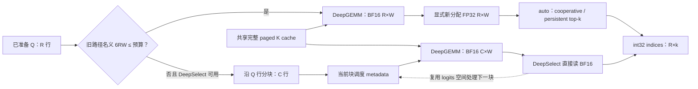

# Indexer logits：显存、kernel 与行分块实验

本次实验确认了三点：**FP32 副本确实存在；按 Q 行分块能大幅降低临时显存；
512 MiB 分块有明显且依赖形状的性能代价。** DeepSelect 并非所有小 batch 都更快。
另外发现既有 top-k 地址计算错误，错误基线已隔离，不能当作性能赢家。

实验没有修改产品行为。输入计划来自 `cg/indexer-topk-breakdown`，结果保存于
`cg/indexer-topk-breakdown-results`。大网格使用历史 PR 产品基线 `cff6224872`；
最终 PR #64138 `4e5b4f8ce9` 的独立 native 库及实际 planner/helper 也做了对照。
二者编译产物不同，报告没有把历史结果冒称为最终 PR 原生性能。

## 结果与证据入口

| 问题 | 结论 | 完整数据与方法 |
| --- | --- | --- |
| 原先到底几份 logits？ | dense 先写 BF16，显式另分配 FP32，转换时同时存在；调用结束可复用 | [MEMORY.md](MEMORY.md) |
| PW 是否算 indexer？ | 算；本分支 breakable PW 在图外算，FULL 捕获其 GPU 链 | [MEMORY.md](MEMORY.md)、[SHAPES.md](SHAPES.md) |
| 512 MiB 是否总峰值上限？ | 不是；padding、metadata、candidate workspace 另计，producer 可达 576.25 MiB | [MEMORY.md](MEMORY.md) |
| 小 batch 保留 FP32 是否有性能依据？ | 有些容量/行数明显更快，另一些更慢；不是单一 batch 阈值能解释 | [TOPK.md](TOPK.md) |
| 分块会不会慢？ | 会；V4.1 c1 的 256 行块在大 R、短上下文损失尤其明显 | [PIPELINE.md](PIPELINE.md) |
| 当前测试模型会不会 OOM？ | 两次默认 .90 压力测试均未 OOM；MRV2 profiling 已覆盖大 decode 分配 | [MEMORY.md](MEMORY.md) |
| 下一步还能优化什么？ | 调度 metadata 跨层复用、块大小/预算解耦、dense mask 与打分选择融合 | [OPTIMIZATION.md](OPTIMIZATION.md) |

环境、source/native SHA、节点与计时口径分别在 [ENV.md](ENV.md)、
[ENV_topk.md](ENV_topk.md)、[ENV_pipeline.md](ENV_pipeline.md)、
[ENV_memory.md](ENV_memory.md)。JSONL 每条配置增量落盘；派生表保留原始 key。

## 数学上切什么，算什么

Indexer 的概念公式为：

`S[q,j] = sum_h w[q,h] * relu(dot(Q[q,h,:], K[j,:]))`。

它没有 V、没有 attention softmax；Q/K projection 在这段之前。SM100 kernel
在 ReLU dot 后已转 BF16，并用四路 BF16 FMA 做 head reduction；不是保留全程
FP32 后最后才 cast。18 组独立 CPU 算术参考、432 个抽样分数与 native 逐位匹配。
BF16 再转 FP32 不会恢复这些舍入。

行分块只切 q：每块仍给每个 query 的完整有效历史 K 打分，然后立即逐行 top-k，
把索引写回全局输出对应行。块间没有分数相加，也不需要二次 top-k 合并。
有效 logits 的分块与未分块检查逐位相同。不同 top-k 实现目标都是精确选值；
BF16 ties 仍可能选择不同 KV 位置，因此这些检查不证明下游模型输出逐位相同。



## 完整选择路径与 256/512/1024 行

以下是最终 PR 的 SM100 varlen、DCP=1 dense 路径：

1. 先用执行的 decode 行数 R 和逻辑容量 W 估算。`auto`/旧 FP32 backend 按
   `6RW`，显式 DeepSelect 按 `2RW`；放得下则保留原 backend、整批算。
2. 超预算时，`auto` 且 DeepSelect 可用才切 DeepSelect；显式 backend 保留选择。
3. 按新 backend 的每行字节数算 C，向下对齐 16，最低 16；尾块可小于 16。
4. 每块执行打分、candidate 操作（若有）、top-k。旧 backend 仍需 FP32 副本。
   旧 `auto` 在支持的 k/布局上 R≤64 用 cooperative，R>64 用 persistent，
   再有 per_row fallback；persistent 名称内部还会选不同 CUDA kernel。

| 逻辑 W | 512 MiB 下旧路径整批最大 R | BF16 DeepSelect 块 C | 保留 FP32 路径块 C | 本轮物理 stride |
| ---: | ---: | ---: | ---: | ---: |
| 1048576 | 85 | 256 | 80 | 1049088 |
| 524288 | 170 | 512 | 160 | 525312 |
| 262144 | 341 | 1024 | 336 | 262656 |

256 行来自 `512 MiB / (1M 列 × 2B)`；512 行对应列宽减半。它们不是矛盾配置。
例如 R1024、W1M：旧路径两份 logits storage 约 6147 MiB；最终路径四块，
每块 BF16 约 512.25 MiB，没有容量宽度 FP32 副本。这里不是释放 K cache。

FULL 应使用**选中 capture bucket 的 padded R**解释阈值，不能每步按 active
request 数重新判断。不同形状的图可以录不同 backend；同一张图 replay 不重跑
Python 分支。varlen 是各 query 行有效历史长度由 device row ends 表示，不是
省略 indexer，也不等同端到端已经测过所有不同 q_i 的混合请求。

## 显存：live、private pool 与日志不能混为一谈

设实际 stride 为 S，本轮 native BF16 storage 为 `2RS`，FP32 storage 为
`4*((R-1)S+W)`。转换期间两者叠加；分块时把 R 换成当前块行数。
最终索引、KV cache、workspace 另外计算。

历史基线 R4096、W262144 的 operator 实测：

| 路径 | 块数 | live peak 增量 MiB | FULL private pool reserved MiB |
| --- | ---: | ---: | ---: |
| 旧 auto | 1 | 6156 | 6156 |
| 单次 BF16 DeepSelect | 1 | 2052 | 2052 |
| FP32 路径，336 行块 | 13 | 504.98 | 510 |
| BF16 DeepSelect，1024 行块 | 4 | 514.00 | 516 |

真实 TP4 V4-Flash-DSpark 同一 BF16/FP32 缓冲跨 21 个 indexer 层复用，
不是 21 份大矩阵同时常驻。FULL1M 的 private pool 约 9.686 GiB，PW 约
2.088 GiB；PW 中 indexer allocation 不在 private pool，但仍有图外运行时分配。
旧截图的“两块 4104 MiB”没有在本次实际模型中复现，不能伪造归因。

**日志名叫 CUDA graph pool memory 的数也不是 private pool 总量。** PW1M
日志 actual 为 16.039 GiB，而 private pool 只有 2.088 GiB；差别包含图外
默认池缓存。MRV2 graph profiling 实际执行 R8192 decode，并非只预留 512 MiB。
两次 .90 压力测试都完成 1024 个请求×256 输出，无 OOM、各 11 次 allocator retry。
最大实际 mixed batch 为 8072 decode＋120 prefill：indexer 峰增 12133.116 MiB，
两份 logits storage 12131.646 MiB，误差约 0.012%。这不证明所有配置都不会 OOM。

同 .85/PW1M 配置显式 DeepSelect：private pool 仍 2.088 GiB，profile estimate
16.719→8.703 GiB，KV 可用空间 89.14→97.16 GiB。普通 prefill 仍有 FP32 转换，
不能宣称整个模型没有任何 FP32 logits。V4.1 candidate source 的 512 MiB 行预算
相对预分配输入、输出的峰增约 576.25 MiB；dense mask fallback 约 544.25 MiB。

## 性能：必须分开看换算子和分块

下面是**实际最终 PR `4e5b4f8ce9` native＋真实 helper**的完整 indexer GPU
流水线，R8192、MXFP4、warm graph，单位微秒；每组 100 次×3 trials。

| 模型形状 / 原始上下文 | 旧 auto | 只换 BF16 DeepSelect | PR 512 MiB | PR 相对旧路径 |
| --- | ---: | ---: | ---: | ---: |
| V4 / 1.5K | 78.14 | 51.20 | 121.44 | +55.4% |
| V4 / 8K | 293.95 | 203.04 | 330.56 | +12.5% |
| V4 / 32K | 621.82 | 441.15 | 584.13 | −6.1% |
| V4.1 c2 / 1.5K | 181.06 | 107.81 | 275.18 | +52.0% |
| V4.1 c2 / 8K | 326.40 | 207.20 | 440.88 | +35.1% |
| V4.1 c2 / 32K | 831.71 | 528.98 | 795.75 | −4.3% |
| V4.1 c1 / 1.5K | 213.60 | 132.40 | 517.44 | +142.2% |
| V4.1 c1 / 8K | 500.61 | 320.66 | 787.54 | +57.3% |
| V4.1 c1 / 32K | 1477.23 | 937.79 | 1492.95 | +1.1% |

原始证据 `results/pipeline_newnative_core.jsonl`，其他 q、128K/full、candidate、
预算与 interleaved 对照见 PIPELINE。这里 c1-none 是隔离打分/top-k 的形状，
实际 candidate producer 的操作成本另测，不能冒充完整 producer 总时间。
R8192 超出本次默认 4096-token FULL capture 上限，手工 graph 是 GPU 成本
对照，不保证生产会选 FULL，也不是整模型 step/serving 延迟。

历史 cff native 的 CUPTI launch trace 证明 c1 的整批与分块 DeepGEMM
都是 grid152、block512，
不是 grid 变小，而是相同 persistent grid 在更少工作上重复启动 32 次。
DeepSelect 则 grid8192→256，每块再做一次。metadata 每块也再跑一次。
完整 FULL graph 去掉 Python 逐块发射，却不会去掉这些 GPU 工作。
图外 eager 的 CPU 成本另测且明显增加，但可能与模型其他 GPU 工作重叠，
不能把孤立 indexer wall 相乘后声称整模型慢同样倍数。

小 batch 的旧 FP32 路径有真实胜点。历史 native、W1M/k512、R1/有效4K：
UP+COOP 约 5.1 微秒，BF16 DeepSelect 约 10.8；R8/full1M 时约 49 对 76。
R64/full1M 又是约 213 对 77，DeepSelect 明显占优。真实 checkpoint layer4、
W65K、R1 时方向反过来：DeepSelect 约 3.46，旧路径约 4.99 微秒。
原因包含容量与 R 触发不同 DeepSelect 配置，不能只凭读字节数或“小 batch”推断。
最终 PR native 的独立 top-k anchors、完整胜者与 CV 复测见 TOPK。


计时均在未锁频、stock power limit 下；重负载观测到 power capping。
几百分点差异需谨慎，不能凭 trial CV 小就断言锁频或端到端提速。

## 下一版 dispatch 的保守实验候选

先保留最终 PR 的显存修复，再考虑预算内的可测收益。候选限制为四条：

```text
if 显式backend 或 DCP>1 或 DeepSelect不支持: 保持原配置路径
elif 6*R*W > 预算: 使用本次PR已有分块路径
elif k属于{512,1024} 且 R>=16: 整批BF16 DeepSelect
else: 保留旧auto
```

这些判断只依赖 capture 时固定的形状/配置，适配现有 FULL 图机制。
按有效上下文挑赢家的离线表只是 oracle；若要 replay 时按长度切实现，
必须另设计 context buckets、图选择或 GPU 分支，不能把 Python 决策塞进 replay。

历史已测预算内点的非流量加权中位 top-k-stage 收益：c1约25%、c2约32%、
V4约36%、V4-Pro约35%；原始点、缺口和 regret 在 TOPK 的 dispatch audit。
这不等于完整 indexer 或模型吞吐。小 R 保守保留 auto 也会漏收益，例如
c1/R6/full 时保留约46.69微秒，DS约21.22；这是已知保守损失。
k2048暂不扩大切换，因存在 R24/ragged 下 DS约29.31对auto21.41的反例。

额外实际 PR-native 小形状 producer 检查已补：R64、MXFP4、c1 candidate
source，raw8K auto19.776→DS16.768微秒，raw32K38.400→28.608，四点均通过
candidate与top-k选值检查；峰增384.19→144.06MiB。证据为
`results/pipeline_rule_candidate_small.jsonl`，同GPU、100次×3trial。

结合已测 c2 与 V4 同 R64 pipeline，可推导**串行 indexer GPU 工作量**：
V4的21层合计约少39/62微秒（raw8K/32K）；V4.1开启sparse-logits时，
3个c2加1个c1 producer合计约少10/24微秒，另4个紧凑consumer不改。
这里是不同单层测量的算术估计，不是实际整模型step测量；显存跨层复用，
也不能把单层省下的临时显存乘层数。配置默认、candidate执行与代码版本须匹配。

## 已追加的新优化实验

主实验后继续做了两项实际 PR-native 实验，均未修改产品源码：

| 方向 | 实测结果 | 适用边界 |
| --- | --- | --- |
| 三个c2层共享每步调度metadata | R4096：三层合计GPU时间减少约48–55微秒，即4.1%–12.8% | metadata仍在每次replay重算；同图原地改变32K→8K→1.5K长度检查通过 |
| dense-mask只写有效历史前缀 | R1024：32K约1528→278微秒，8K约1424→173微秒 | 仅BF16＋end-aware DeepSelect的decode fallback；不覆盖已走紧凑sparse-logits的层 |

第一项把24次调度更新降为8次，DeepGEMM/top-k仍各24次，能实际消除一部分
跨层重复工作。第二项消除无效容量范围的写入，没有额外降低logits容量分配；
8/32/128 programs-per-row已做小范围对照，不宣称已完成所有形状调优。
两项的GPU输入长度变化、正确性、源码hash、试验数据与设计约束见
[OPTIMIZATION.md](OPTIMIZATION.md)。这些是局部kernel机会，不是模型提速比例。

更深入的方向是减少分块造成的重复persistent DeepGEMM启动，或设计有界scratch
的打分/选择流水线；当前没有实现，不能把“单次DS与分块的差值”全算成可获得收益。
context graph buckets也需要显式图key与外部调度变更。建议先做metadata共享这个
边界较清楚的改动，再单独处理dense-mask consumer契约和既有地址溢出。

## 正确性发现与尚未完成的验证

vLLM direct filtered top-k 的 `uint32 bid * stride` 会先回绕。结构化输入证明
W1M 的 row4095 精确读到回绕地址；真实 PR native 的 R4096/短实际 host bound
也复现一行错值。actual-bound filtered 路径在 R8192 的 c1/c2 分别可有
4097/15 行错值；上表使用 capture-bound，有效基线不受此地址分支影响。
这是既有缺陷，PR 没改这个 kernel；错误臂拒绝计时、不参与 winner。
另在 FlashInfer0.7.2 clusters 分支复现独立 signed32 地址溢出和 CUDA IMA，
已保留 core 调试证据，且该分支还会额外分配巨大 overflow workspace。
本实验没有修改产品或第三方代码，没有提交上游 issue/PR。

三层真实 V4 checkpoint 分数及 matched controls、图 replay 后改变长度/分数
均已检查。便携 BF16 原始矩阵保存在 JSONL archive，可还原；不是把随机 Q/K
生成的分数称为模型激活。V4.1 checkpoint 激活、HY-v4 实际 checkpoint、
DCP>1、H100/200、最终规则的模型 accuracy/serving 验证仍未覆盖。

没有完成计划可选 Phase5 的 model-forward 全网格；本次优先给出了实际模型
内存、真实激活、最终 PR native pipeline 与广泛 top-k 对照。性能建议是待实现、
待模型验证的实验候选，不声称已完成端到端提速或准确率验收。
