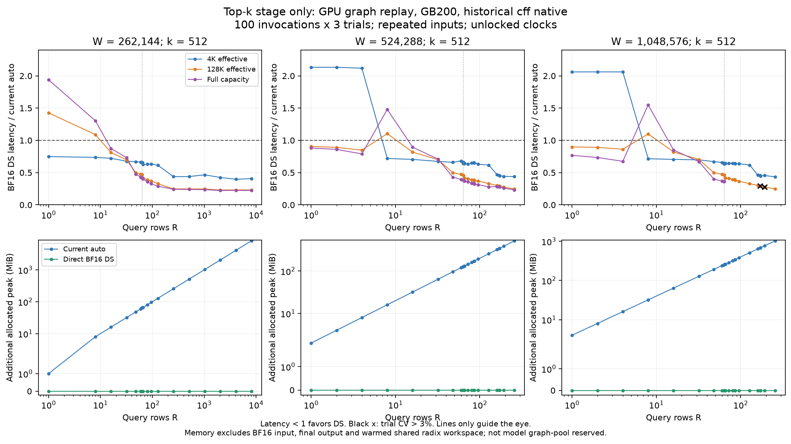

# Top-k experiments

Status: measurements and audits complete within the explicit coverage below.

Runner: `benchmarks/kernels/benchmark_indexer_decode_topk_breakdown.py`.
Method and caveats: [ENV_topk.md](ENV_topk.md).

## Smoke test

`results/topk_smoke.jsonl` contains 18 arms: R=8, capacity=262144,
effective length=4096, k=512, graph/eager, BF16 DeepSelect, upcast followed by
cooperative/persistent/FP32 DeepSelect/FlashInfer/per-row, both FP32-only arms,
and upcast alone. These are 3-repeat functional smoke observations, not final
performance evidence.

All available arms ran and returned CUPTI activities. Every selection arm had
zero count, bounds, duplicate or sentinel violations, and zero selected-value
multiset mismatches on the eight exact-reference rows. Some persistent,
FlashInfer and per-row index sets differed due to BF16 ties. The difference is
recorded rather than incorrectly counted as a value-selection failure.

## Scheduling

A five-minute dev01 probe completed 383 records in 300.76s: 354 timed and 29
expected unsupported cooperative rows>64, zero unexpected errors. This is
1.18 timed records/s including exact/sampled correctness, fresh graph capture,
100 span and 100 per-kernel repeats, host timing, telemetry and immediate fsync.
Initialization/JIT before the probe's internal timer is excluded. Initial
priority is V4.1 capacities 1M and 512K,
including R=85/86 and 170/171 budget boundaries and R=64/65 cooperative boundary;
then V4 capacity256K, additional model widths/top-k sizes, warm/cold, eager,
padding/tie correctness and large-row controls.

The dedicated04 scan starts with 23 rows (1,2,4,8,16,32,48,60,63,64,65,66,72,
80,85,86,96,128,160,170,171,192,256), all five short/mid/long/full/ragged
profiles, both 1M and512K capacities, all seven primary arms including FP32-only,
and actual/capture bounds where meaningful. It then scans V4 capacity256K
including R512/1024/2048/4096/8192. Every core point uses100 repeats×3 trials.
Capture bounds are fixed at the actual uncompressed model maximum1M.

The unused-host-bound duplicate arms are pruned because DeepSelect, FlashInfer,
per-row and upcast-only ignore that argument. Cooperative/persistent retain
both bounds. This saves time for actual threshold and kernel comparisons.
The plan's full Cartesian P0 grid is too large; scheduling preserves production
widths, k512, dense small-batch crossover and large-row controls first, then
expands top-k sizes, cache/execution modes and correctness stress cases.

Final tables must exclude smoke measurements and distinguish source revision,
GPU host, actual length versus baked capture bound, GPU activity sum versus
span, and standalone replay locality versus producer-warmed pipeline locality.

## What the backend names actually run

- Cooperative: one cooperative cluster per row; cluster size16/8/4/2 for
  rows<=4/<=8/<=33/<=64. The C++ interface has a hard rows<=64 bound and
  explicitly ignores `max_seq_len`; actual/capture measurements are a negative
  control here. See `csrc/cooperative_topk.cu`.
- Persistent: an API/backend name that dispatches to several implementations.
  On SM100, rows>64 and host bound>=98304 for k512 (>=65536 for k1024/2048)
  selects `sampled_topk_kernel`; otherwise rows>32 selects `FilteredTopK`.
  Smaller rows run `persistent_topk_kernel` with a separate workspace memset.
  A long capture host bound can therefore select a different CUDA kernel even
  when the runtime lengths are short. See `csrc/topk.cu` and
  `csrc/sampled_topk.cuh`.
- DeepSelect: BF16 and FP32 dispatch to different implementations, not simply
  the same kernel reading elements of different size. CUPTI on the first
  completed R1/W1M/ctx4K/k512 case identifies a BF16 cluster16 kernel versus
  the separate `topk_select_fp32` implementation. Timings must be compared
  directly; halving input bytes is not by itself a speed guarantee.

## Saved-score distribution checks

The pipeline agent supplied six score samples: actual MXFP4/FP8 DeepGEMM
outputs from synthetic Q/K, for V4 and V4.1 compression1/2. These are explicitly
**not checkpoint-model activations**. Each stores128 BF16 rows and32768 valid
columns, seq_lens and provenance. The `file` profile tiles saved rows and lengths
to the requested batch, allocates the original full capacity/stride, copies the
valid prefix, and fills invalid tails with-inf. It never treats the invalid
tail as actual observed scores. File SHA256 and metadata are recorded.

`topk_samples.sh` replays all six distributions at the key row counts after
the primary scan, with a randn control matched to the exact saved row lengths
and strides for each model shape. Optional replay checks also validate the
captured graph after100 replays, then update length tensor contents (including
empty and fewer-than-k rows), replay again and compare against a fresh reference.
The original lengths are restored afterward.

The memory agent then supplied actual V4-Flash-DSpark checkpoint activations from layers2/4/6:
`results/memory_real_logits.jsonl` records their provenance and hashes. Each
sample contains8 rows×2565 saved columns, with effective lengths2563–2565,
full production shape[8,65536] and stride[66048,1]. This run used configured
M262144, compression4, one request with K7 verification, MXFP4 indexer Q/K and
PW/eager auto→cooperative selection. Its exact raw host maximum is10261,
which cannot be reconstructed as compressed_max×4. The separate attention KV
format is fp8_ds_mla; it is not the indexer Q/K format.

`topk_real_samples.sh` prioritizes these three layers and exact-length/stride
matched randn controls, with all A/B arms and trials on GPU2. Repeating eight
saved rows to larger batches is a controlled distribution/scaling experiment,
not a claim to have collected independent activations at every concurrency.
V4.1 checkpoint activation distributions remain uncovered; its six synthetic
Q/K-generated score samples are labeled separately.

The three small real activation matrices are archived bit-for-bit as BF16 in
`results/topk_real_samples_archive.jsonl` (166KiB), with original file hashes,
raw tensor hashes and model/trace provenance. Run
`bash benchmarks/kernels/indexer_breakdown/topk_materialize_real_samples.sh OUTPUT_DIRECTORY`
to reconstruct portable `.pt` inputs. A CPU round-trip verified exact tensor
and seq_lens equality for all three. Repacking `.pt` changes its container hash;
the original and raw tensor hashes remain explicit in the reconstructed metadata.

Initial dedicated04 R1/W1M/ctx4K/k512 graph observations (three trials,
100 invocations each): BF16 DeepSelect10.78–10.82us; UP+COOP5.09–5.54us;
UP+DS-fp32 6.53–6.82us. The FP32 DeepSelect kernel itself is approximately
5.25us and upcast approximately1.31us in the first detailed trace. These are
one-shape observations, not a proposed global dispatch rule. Source:
`results/topk_v41c1_core.jsonl` filtered to rows1, profile short.

## 独立正确性发现：filtered 分支的 uint32 行地址溢出

`csrc/persistent_topk.cuh` 的 `FilteredTopKUnifiedKernel` 使用
`input + bid * max_len`；`bid` 和 `max_len` 都是uint32。实际stride1049088
时，row4095的元素偏移4296015360超过2^32，回绕到1048064。
这在R>=4096、W1M、短host-bound进入filtered时可以触发。

两层验证均已完成，未改产品代码：

- `results/topk_u32_probe.jsonl`：R4096/W1M/有效4K随机BF16→FP32，
  actual4K→filtered出现1/128参考行选值错误；capture1M→sampled为0。
  两者的数量、范围、重复和-1检查均正常，单看这些检查会漏掉错误。
- `topk_u32_diagnostic.sh` 使用全初始化的FP32 stride存储；有效元素设为
  `(column + 997*row) % 4096`，其余和padding均为-100，消除未初始化数据影响。
  `results/topk_u32_diagnostic.jsonl` 给出精确的边界行证据：

| Host bound / kernel | Row | 正确参考索引区间 | 实际输出区间 | 正确参考重合 | 回绕地址参考重合 |
| --- | ---: | ---: | ---: | ---: | ---: |
| 4096 / filtered | 4093 | 2479–2990 | 2479–2990 | 512/512 | 512/512 |
| 4096 / filtered | 4094 | 1482–1993 | 1482–1993 | 512/512 | 512/512 |
| 4096 / filtered | 4095 | 485–996 | 3584–4095 | 0/512 | 512/512 |
| 1048576 / sampled | 4095 | 485–996 | 485–996 | 512/512 | 0/512 |

这是地址计算的错误，不能作为数值近似或ties接受。相关filtered基线会从性能
winner/dispatch建议中排除。主core的C1/C2最高256行和V4最高8192行均未触及
这个地址边界；FULL-bound sampled分支使用int64 stride，边界对照正确。
后续修复应在乘法前提升行索引到64位，并通过同一公开算子的边界测试验证；
本实验分支只记录发现，不应用产品修复。

版本范围已由verify agent仅CPU核查：latest-main `9bc1c8b4fe`、最终PR
head `4e5b4f8ce9`、base `b4a0830f66` 的该文件都对应blob
`bd18483b48d0ae6aed27a9829baa4283a1212cc6`，L1077–1084仍保留同一uint32
表达式。因此是已有源级问题，非该PR新引入。这里的结构化指针诊断使用历史cff
产物；pipeline agent随后还在PR `4e5b4f8ce9` 的实际native库上复现了
R4096/C1/actual-bound的错误，见 `PIPELINE.md` 的new-native结果。

## FlashInfer 0.7.2 大stride错误与额外显存

可选 `UP+FI` 臂在R4096/W524288/stride525312、有效32K列时出现非法地址。
不是给该方案计一个慢时间再继续：这组及同R更大capacity从正式扫描隔离。
两次新进程/default allocator探针没有致命退出，但各有1/128参考行选值错误，
同样不接受为有效性能结果。更大的W1M只作保守隔离，没有声称已复现。

按照vLLM官方core-dump调试流程，在新进程加
`PYTORCH_CUDA_ALLOC_CONF=expandable_segments:True` 后复现了硬错误。
cuda-gdb定位 `fast_topk_clusters_exact_ragged_transform_kernel<float,1,false>`，
block4091/thread608在 `fast_topk_clusters_exact.cuh:175` 读取logits时
`WarpIllegalAddress`。同header L506–507写的是：

```cpp
int cluster_id = blockIdx.x / NClusters;
int64_t logit_offset = cluster_id * logit_stride;
```

两侧先做32位signed乘法，再存入64位变量。stride525312从row4089起越过
INT32_MAX，与故障位置吻合。这与前一节vLLM的unsigned32问题是两套独立实现。
core寄存器也闭合了地址证据：block4091的R13=`0x8017ec00`恰是
4091×525312的32位乘积；logits base=`0x440fff800`，故障读取地址
`0x2415fb180`恰等于base＋4×(signed32乘积＋thread608)，而正确64位
读取应为 `0x6415fb180`。见 `topk_fi_core_address.log`，不是仅凭源码猜测。
未改任何第三方源文件，也未提交上游issue或修复。

版本固定为FlashInfer0.7.2，build commit
`d84335d8c54e0c8f9f7e22faa15c7e34a58abf94`，对应
[ragged clusters源码](https://github.com/flashinfer-ai/flashinfer/blob/d84335d8c54e0c8f9f7e22faa15c7e34a58abf94/include/flashinfer/fast_topk_clusters_exact.cuh#L497-L528)；本地header SHA256见
`results/topk_fi_fault_diagnostic.jsonl`。55,864,329-byte GPU core保存在
共享cache，仓库中有 `topk_fi_core_focus.log` 的完整回溯和反汇编。
`topk_fi_ima_probe.sh` 支持显式allocator/launch-blocking/output参数以复现。

此外该clusters实现会分配 `R × 4 × W` 个int32 overflow元素，即约
`16 × R × W` 字节：上述shape单是overflow就32GiB，加上8GiB FP32副本等，
fresh probe实测additional allocated peak约40.023GiB，尚不含约4.008GiB
BF16输入。即使修复地址问题，也不能把这个版本的该分支当成节省logits显存的
直接替代。这个结论限定于实际调用到的clusters分支，不能泛化到FlashInfer所有
top-k算法。

失败证据：`results/topk_failures.jsonl`、`topk_fi_{ima,noblock,expand}_probe.log`、
`results/topk_fi_fault_diagnostic.jsonl`、`results/topk_unsafe_cases.jsonl`。
主runner现在在每次GPU尝试前落盘spec；遇到sticky CUDA错误先记录再退出，
不在损坏context里调用empty_cache掩盖原错误。expandable probe的进程abort前
已成功留下attempt行，验证这一增量记录路径。
后续进程还会在warmup后的选值/索引校验失败时直接记
`status=invalid_selection`，跳过计时；早期已带有timing但校验失败的原始行
保留作证据，摘要一律标invalid，CV复测和winner表不使用它们。

## 动态CUDA graph输入验证

`topk_dynamic_graph.sh` 对DS-bf16、UP+COOP、UP+PERS分别捕获一次：
固定R8/W1M/stride1049088、host max1M，capture时有效长度4K。
随后只更新原地tensor内容，按0、128、8K、32K、128K、1M、4K改变长度，
最后再把BF16输入符号翻转。24个状态全部选值、数量、范围、重复和-1检查通过。

- 同一图的kernel节点名保持不变，GPU内部根据新长度改变实际工作量。
- 每种方案Python top-k provider只被warmup3次＋capture1次调用；replay后仍为4。
  UP方案的Python upcast函数也一直是4次，但GPU转换kernel每次replay都执行。
- 原地翻转输入后，三种方案各8/8行的选中集合都改变，并与新输入参考一致。

原始数据：`results/topk_dynamic_graph.jsonl`。这验证了图重放重新读取输入、
重新计算结果；Python选择/分配路径不会在每次replay重新执行。固定图中的GPU
kernel仍可执行依赖seq_lens数据的分支和循环。

## Dedicated C1 core: initial three trials complete

W=1048576, k=512, padded stride1049088, graph replay, repeated-input warm.
939 successful configurations each have exactly100 repetitions×3 trials;
2817 timed records plus17 sentinels and702 expected unsupported cooperative
records above64 rows. No observed count/bounds/duplicate/sentinel/selected-value
failures; large batches use the explicitly recorded128-row exact-reference
sample. Fifteen configurations initially had trial CV>3%; targeted reruns are retained separately.
Maximum fixed-sentinel drift is0.663%. Derived aggregates and exact source keys:
`results/topk_summary_c1_initial.jsonl`.

These are top-k-stage GPU spans, excluding DeepGEMM, in microseconds. Current
auto means UP+COOP at R<=64, UP+PERS otherwise; the host bound is1M as in FULL
capture. DeepSelect ignores that host bound. Each value is the median of the
three trial medians. Negative delta means lower stage latency.

| R | Effective columns | Current auto us | BF16 DS us | DS latency delta |
| ---: | ---: | ---: | ---: | ---: |
| 1 | 4096 | 5.09 | 10.82 | +112.6% |
| 1 | 131072 | 13.22 | 11.81 | -10.7% |
| 1 | 1048576 | 26.91 | 20.67 | -23.2% |
| 4 | 4096 | 5.22 | 10.82 | +107.4% |
| 4 | 131072 | 13.98 | 11.92 | -14.8% |
| 4 | 1048576 | 31.17 | 21.06 | -32.4% |
| 8 | 4096 | 5.28 | 3.78 | -28.5% |
| 8 | 131072 | 15.17 | 16.67 | +9.9% |
| 8 | 1048576 | 49.12 | 76.06 | +54.9% |
| 16 | 4096 | 5.15 | 3.74 | -27.3% |
| 16 | 131072 | 20.43 | 16.67 | -18.4% |
| 16 | 1048576 | 89.38 | 76.06 | -14.9% |
| 32 | 4096 | 5.57 | 3.78 | -32.2% |
| 32 | 131072 | 23.58 | 16.70 | -29.2% |
| 32 | 1048576 | 113.89 | 76.26 | -33.0% |
| 64 | 4096 | 5.95 | 3.78 | -36.6% |
| 64 | 131072 | 36.42 | 16.83 | -53.8% |
| 64 | 1048576 | 212.75 | 76.93 | -63.8% |
| 65 | 4096 | 5.86 | 3.78 | -35.5% |
| 65 | 131072 | 40.67 | 16.86 | -58.5% |
| 65 | 1048576 | 213.68 | 76.85 | -64.0% |
| 85 | 4096 | 5.98 | 3.84 | -35.8% |
| 85 | 131072 | 43.33 | 16.99 | -60.8% |
| 85 | 1048576 | 239.09 | 77.18 | -67.7% |
| 86 | 4096 | 5.98 | 3.81 | -36.4% |
| 86 | 131072 | 44.45 | 17.02 | -61.7% |
| 86 | 1048576 | 246.42 | 77.28 | -68.6% |
| 128 | 4096 | 6.27 | 3.87 | -38.3% |
| 128 | 131072 | 52.24 | 17.18 | -67.1% |
| 128 | 1048576 | 297.74 | 77.63 | -73.9% |
| 256 | 4096 | 9.86 | 4.29 | -56.5% |
| 256 | 131072 | 104.67 | 25.95 | -75.2% |
| 256 | 1048576 | 577.25 | 126.90 | -78.0% |

三个初始k512主core均已跑完（补充网格仍在跑）：

| 主core | 成功配置 | 100次×3 trial的timed行 | 哨兵行 | 预期COOP>64不支持 |
| --- | ---: | ---: | ---: | ---: |
| V4.1 c1/W1M | 939 | 2817 | 17 | 702 |
| V4.1 c2/W512K | 905 | 2715 | 15 | 390 |
| V4 c4/W256K | 745 | 2235 | 12 | 330 |

三个主core全部已测选值/数量/范围/重复/-1错误为0；大rows的选值检查是明确
记录的128行参考抽样，不能写成逐行穷尽证明。初始trial CV>3%的配置分别15、2、11，
后续复测保留原始行，仍有噪声的组继续标记。`topk_analyze.sh` 再生
`results/topk_summary_{all,inventory}.jsonl`，每组带source SHA/byte长度、原始key、
选择有效性和CV。若有后续复测，摘要明确选用哪三次trial，不混平均成六次。



上排低于1表示直接BF16 DeepSelect更快；下排是额外allocated峰值，
不包含BF16输入，也不是整个模型graph pool的reserved。图由
`topk_analyze.sh`、`topk_plot.sh` 再生，原始key和图文件hash在
`results/topk_plot_manifest.jsonl`。这是历史cff native的top-k阶段图，
不能直接当作最终PR整层indexer加速图。

## FP32“分配多少”和“转换多少”是两件事

`as_fp32_logits` 按完整capacity/stride分配FP32，但kernel只转换每行有效列。
因此短上下文也能占很大容量，却不代表每步把整个capacity都读写了一遍。
以下是相同graph/warm协议下的纯UP-only，原始key可在summary中定位：

| W / R | 有效列 | FP32额外allocated MiB | 有效转换读写 MiB | UP-only us |
| --- | ---: | ---: | ---: | ---: |
| 1M / 64 | 4K | 256.123 | 1.5 | 1.920 |
| 1M / 64 | 128K | 256.123 | 48 | 11.552 |
| 1M / 64 | 1M | 256.123 | 384 | 85.376 |
| 1M / 256 | 4K | 1024.498 | 6 | 2.608 |
| 1M / 256 | 1M | 1024.498 | 1536 | 329.888 |
| 256K / 8192 | 4K | 8208 | 192 | 41.600 |
| 256K / 8192 | 256K | 8208 | 12288 | 2400.882 |

有效流量按 `6 × sum(seq_lens)` 算，未使用HBM交易计数器，不能当成实际
HBM流量。大点对应约4.5–5.4TB/s有效读写率，小点主要有固定成本和cache影响；
没有看到明显不可能的量级。去掉FP32副本的显存收益可以很大，而短上下文时
省掉upcast本身的时间只有几微秒。Top-k算法、内部配置和分块代价也必须分开看。

同一C1主core的实际kernel分解进一步说明这一点（us）：

| R / 有效列 | UP+COOP整段span | 其中upcast kernel | 其中COOP kernel | BF16 DS span |
| --- | ---: | ---: | ---: | ---: |
| 1 / 4K | 5.248 | 1.312 | 3.648 | 10.816 |
| 8 / 1M | 49.121 | 11.136 | 37.776 | 76.065 |
| 64 / 4K | 5.952 | 1.728 | 4.000 | 3.776 |
| 64 / 1M | 212.752 | 83.408 | 128.912 | 76.928 |

这张分解表用COOP的actual-bound负对照（该算子忽略host bound）；上面的
FULL表在可用时用capture-bound。两组是独立trial，不能把几十分之一微秒差
解释成参数效果。kernel分解又是独立CUPTI采样，不要求分项中位数严格加和等于
public span。R64/1M既省转换也换了更快的选择kernel；R8/1M则选择kernel本身
更慢，省11us转换仍然不够。不能把所有收益都记在FP32副本上。

## 为什么小rows会出现反转

这里的backend是**indexer每行top-k的实现选择**，不是attention backend，
也不是DeepGEMM；DeepGEMM先产出分数，这几种实现再消费分数。

| 名称 | 本分支实际角色 | dtype/限制 |
| --- | --- | --- |
| cooperative | cluster内多个CTA合作处理一行；小rows时扩展行内并行 | FP32；R≤64；k512/1024/2048 |
| persistent | vLLM的另一入口；内部还会按rows、host bound、SM资源选persistent/filtered/sampled kernel | FP32；k512/1024/2048 |
| DeepSelect | 独立extension中的精确top-k选择实现，也包含cluster/normal等内部配置 | 可直接BF16或FP32；SM100；k≤4096及stride约束 |
| FlashInfer | 本次可选第三方top-k入口；此版本实际走clusters exact ragged | 该调用FP32；大stride错误臂隔离 |

“精确”在这里是相对于已存下来的BF16分数做精确top-k选值。BF16→FP32
不会恢复更高精度的原始打分。边界并列值可让不同实现选不同KV位置；虽然
选值多重集一致，下游attention读取的内容仍可能不同，因此这里没有证明模型
输出逐位一致，也没有用microbenchmark替代accuracy评测。

本地 `cooperative_topk.cu` 明确忽略host `max_seq_len`，按R选cluster大小
16(R≤4)、8(R≤8)、4(R≤33)、2(R≤64)。因此它与persistent的分流是
行内并行方式和适用工作负载的选择，并非两个不同的数学操作。
`auto` 的64行阈值是已有工程规则；本实验会比较64附近的台阶，但显式cooperative
在65行就被接口拒绝，不能声称已实测把它扩展到65行之后的效果。

不能只用“BF16读一半字节”解释所有点。tree的CMake固定DeepSelect
`d96d33afe1fab0d6066da49cdc91e64c2bee65ea`；该版本
[host dispatch](https://github.com/vllm-project/DeepSelect/blob/d96d33afe1fab0d6066da49cdc91e64c2bee65ea/csrc/api.cpp#L129-L188)
会在BF16、R≤6、capacity≥512K、k≤1024时选16-CTA cluster方案。
其他小rows走普通512-thread CTA，R超过SM数后k512/1024又切另一套256-thread
配置。k2048属于不同coverage tuple，不能拿k512的性能直接外推。

CUPTI确实在R1/W1M看到了cluster kernel，而R8同width是普通grid8的kernel。
R1短4K时cluster约10.8us，旧UP+COOP约5.1us；capacity降到256K则
不满足cluster条件，R1短4K的BF16 DS约3.8us。R8长行时普通方案又只有8个
CTA分布到152个SM，旧路径可再次更快。这是源级dispatch和实测配置支持的
解释；未把资源上限当成实测occupancy，也未声称每个差值都已用硬件计数器拆解。

## 可进一步验证的dispatch候选

这只是实验建议；本分支没有修改产品dispatch。保留现有PR的显存处理，新增
性能选择只发生在**预算内**，且不按每步运行时ctx改变FULL graph：

```text
if explicit_backend or DCP > 1 or DeepSelect约束不满足:
    保留现有route
elif 现有PR预算规则要求切换或分块:
    保留现有PR预算route
elif k in {512, 1024} and R >= 16:
    DeepSelect(BF16)
else:
    auto
```

每张图在capture前/时按R、k、capacity和配置固定这条路径。下表使用同卡、
同native版本、graph/warm、选值正确且完整三trial的配对，统计现有512MiB预算内
的形状；是**top-k阶段**收益，未包括DeepGEMM、candidate、分块或整个模型。
每个row/profile等权，仅用于描述覆盖网格，不是生产请求分布加权的预期值。

| 历史cff主模型网格 | 预算内配对点 | 候选相对auto的中位节省us / % | 预算内相对二选一oracle的最大regret |
| --- | ---: | ---: | --- |
| C1 / W1M / k512 | 162 | 2.112 / 24.91% | R6/full：25.472us，+120.06% |
| C2 / W512K / k512 | 186 | 4.800 / 32.29% | R6/full：11.712us，+68.41% |
| V4 / W256K / k512 | 204 | 5.264 / 35.66% | R12/mid：4.544us，+55.69% |
| V4-Pro / W256K / k1024 | 204 | 4.592 / 34.55% | R12/mid：4.448us，+52.45% |
| V3.2 / W160K / k2048 | 216 | 0 / 0%（保留auto） | R384/spec：86.465us，+161.03% |

这里的oracle可对每个有效ctx挑auto/DS中较快者；这**不是**现有FULL graph可
自动执行的策略。最大regret主要来自小R保留auto，因此是放弃潜在加速，
不是相对当前auto新增变慢。在已配对k512/1024网格中，R≥16未观察到DS慢于auto；
不能把它外推成所有输入分布/未来kernel的保证。k2048不能直接套此规则：例如
历史V3.2的R24/ragged为auto21.408us、DS29.312us，强制DS会慢36.92%。

显存方面，预算内也能去掉FP32临时量：例如C1/R64约256.123MiB、
C2/R128约256.496MiB、V4/R256约256.498MiB的额外allocated；这些不是各层
相加的模型pool常驻量。组合流水线和逐层估计见PIPELINE.md，不能把上表直接
当成模型吞吐或把大R原本已走DS的收益重复计入这个候选。

`topk_dispatch_audit.sh` 再生 `results/topk_summary_dispatch.jsonl`，包含每个
配对点的原始key/source SHA、预算阈值、缺失点和regret，可审计上述统计。

## 实际PR-native复核

PR `4e5b4f8ce9` 的独立native库复核重现了小R反转（us，auto→BF16 DS）：

| W / R / 有效列 | 实际PR-native结果 |
| --- | ---: |
| 1M / 1 / 4K | 5.184 → 10.784 |
| 1M / 6 / full | 46.719 → 21.120 |
| 1M / 7 / full | 47.904 → 75.968 |
| 1M / 16 / 128K | 18.720 → 16.672 |
| 1M / 64 / full | 212.928 → 76.832 |
| 512K / 7 / full | 29.280 → 44.256 |
| 256K / 1 / 4K | 5.216 → 3.808 |

方向与历史cff一致；legacy native的数值会变化，不能混作同一baseline。
DeepSelect extension在两套环境中SHA256完全一致，legacy native库则不同。
三份k512 anchor文件及新增k1024/V4-Pro、k2048/V3.2六行关键anchor分别保存
在 `topk_newnative_*.jsonl`；后两份均已完成且self-CV无待复测组。
这是有限形状复核，不是声称完整P0都在PR-native重跑过。

## 封口范围与限制

- 主width k512的C1、C2、V4均覆盖45个P0行数×6种长度分布的auto/DS配对。
  V3.2/k2048同样270对；V4-Pro/k1024有266对，R8192的mid/long/full/ragged
  未完成完整三trial协议，排除定量比较。
- 64K短cap的k1024/k2048完成完整行数/长度网格；k512因16:15时间盒停到R320，
  后续大R只有前期关键点，不宣称完成64K的全P0。两种standalone FP32-only
  反事实在64K网格被裁剪，主width保留；FI/PERROW使用计划中的稀疏网格。
- 所有接受的正式配置至少100次×3trial；不完整组、错误选值组和旧floor-flush
  cold协议不作正式winner。CV>3%组已安排一次复测；部分eager GPU span仍很
  波动，主要包含CPU发射间隙，保留noisy标签，不用其小百分比差异推荐dispatch。
- 早期C1/C2 core和probe共5910条timed行没有gpu_uuid字段；其hostname、
  CUDA_VISIBLE_DEVICES和job仍在。主core设备由同一Slurm40469的ENV冻结映射
  确认为04/GPU0，不把缺字段补写成原始实测值。后期全部保留UUID。
- 三层真实checkpoint输入只覆盖一个约10K原始上下文的短cap部署；长上下文
  的真实训练激活分布未测。synthetic QK经真实DeepGEMM得到的六份样本明确
  标为synthetic，不冒充checkpoint激活。未做DCP>1、H100/H200或模型accuracy评测。
- 全JSON解析、重复key、四份stash恢复anchor raw/attempt的完整性和trial数由
  `results/topk_summary_schema_audit.jsonl` 给出；初始诊断错误数据保留，不改写。
  图和派生表可通过analysis/dispatch/plot三个脚本重建。

最终CPU封口审计：67,901条timed raw、0条JSON解析错误、0个timed重复key；
满足同节点、完整100×3、有效选值及正式flush协议的组为21,754。
一次CV复测后仍标noisy的组为eager438、graph35，均保留标签。
两份新增model-native anchor分别96组/102组，全部完整三trial。
pre-commit自动stash曾与append竞态；原patch恢复后，缺失case用同spec新进程
`--resume`补测，保留新pid/unix_time，不冒充原trial时间。两份attempt日志各有
一个重复key（重试）及一个未保留下来的旧attempt；timed raw仍唯一且齐全。
详见 `results/topk_recovery_audit.jsonl`，没有删除这些重试痕迹。
