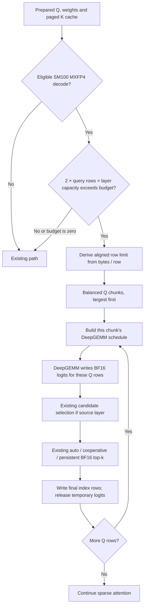

# PR2 code review guide

[Review PR2 only on GitHub](https://github.com/Pb314314/vllm/compare/c86f902b07ec2adfe691e7322b38f9d688c86343...d51f40aeffe014e4ee1f77759b22501893f84d5e).

Separate prerequisites: [BF16 reconciliation](https://github.com/Pb314314/vllm/commit/d839fe26bd21e37018b2bfb93526b9cd7d5bf44a), [address-width correction](https://github.com/Pb314314/vllm/commit/c86f902b07ec2adfe691e7322b38f9d688c86343).

## Scope

Review `PR2_ONLY.patch` against the archived combined BF16 baseline. It adds 202 production Python lines, 46 focused test lines, 19 user-documentation lines, and a separate 1080-line reproducible benchmark directory. No native CUDA implementation changes are part of that patch. `SOURCE_HASHES.json` fixes before/after identity for every file.

The worktree also contains prerequisite cooperative integration edits. Those are **not** PR2. `ADDRESS_DEPENDENCY.patch` is a separately identified two-expression correction required by the large unchunked benchmark baseline; both timing arms used it. Review and integrate that dependency explicitly before reproducing the largest cases.

## Execution flow

FULL capture records the GPU operations for **all** chunks in one graph. One replay executes that fixed sequence on updated buffers. It does not run the Python loop again. Eager executes the same loop and pays CPU dispatch per chunk. K is not partitioned by this implementation, and Q/K projections are not repeated.

## Suggested review order

1. `after/vllm/envs.py`: configurable MiB budget, default 2048, zero disables.
2. `after/vllm/model_executor/layers/sparse_attn_indexer.py`: `_decode_chunk_ranges` covers every row once, aligns starts, bounds payload and orders large allocations first.
3. `_decode_chunk_profile_bytes`: accounts for padded BF16 logits, schedule, candidate scores and fallback outputs, plus allocation rounding. Payload budget is not a graph-pool cap.
4. `_varlen_decode_rows`: slices all row-dependent metadata consistently, recomputes a chunk-local schedule, retains candidate score dtype/selection, and writes output to its original row range. No whole-logits FP32 conversion or DeepSelect switch is introduced.
5. `chunk_decode` eligibility plus the profile branch and decode branch: unsupported paths and batches that fit retain the original flow. No GPU-to-host read is added.
6. `after/tests/kernels/test_top_k_per_row.py`: coverage/ordering/tail/budget and observed allocation-rounding regressions. GPU data/graph behavior is additionally exercised by the retained benchmark and serving receipts.
7. `REPORT.md`: scope, uncertainty, default rationale, performance regressions and correctness acceptance. Do not equate correct final answers with generated-token identity.

## Integration notes

Prerequisites: persistent #64138, cooperative #62172 and the separately reviewed address-width correction. Related #62169 is SM90/SM120 uniform decode, while PR2 is SM100 varlen. Both touch the caller and need reconciliation; neither a conflict-free textual merge nor universal hardware support is claimed.

The report and patch are English and AI-assisted. Human review/testing confirmation has not been recorded for this final patch.
