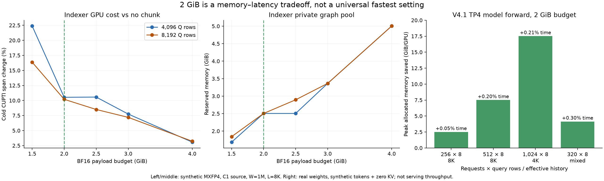

# Decode indexer chunking: evidence, 2026-10-30

This separate evidence branch supports the PR2 code at `d51f40aeffe014e4ee1f77759b22501893f84d5e`; it is not additional production code intended for the PR diff. AI assistance was used. Human review and relevant-test confirmation are still required before submission.

- [Full report: rationale, timings, memory, correctness and limitations](REPORT.md)
- [PR2-only code diff](https://github.com/Pb314314/vllm/compare/c86f902b07ec2adfe691e7322b38f9d688c86343...d51f40aeffe014e4ee1f77759b22501893f84d5e)
- [Execution flow and code review guide](CODE_REVIEW_GUIDE.md)
- [Human review and quick reproduction](HUMAN_REVIEW.md)
- [Full reproduction map](REPRODUCE.md)
- [Final 2/4 GiB model-forward comparison](refinement_MODEL.md)
- [1/1.5/2/4 GiB model cross-check](low_budget_MODEL.md)
- [Controlled eager comparison, including baseline drift](eager_pairs_MODEL.md)
- [Serving/PD/startup receipts](FUNCTIONAL_SUMMARY.json)

The initial recommendation is a configurable **2048 MiB BF16 logits payload** budget, with `0` to disable and `4096` for fewer chunks at higher temporary memory. This is a measured compromise on the covered GB200 workloads, not a universal optimum. Whole-model graph-forward overhead is small in the measured cases; eager and individual indexer calls can regress materially. See the report before reusing any percentage.

## Raw evidence

`RAW_TIMINGS.json.gz` contains the original numerical records, all raw timing samples, memory measurements, case parameters, source/binary identities and score/top-k proofs. It includes the coarse, refined, allocator-order, tail-policy, fallback, model-forward and controlled-eager stages. Stage implementations differ as documented; do not combine them into one timing distribution. Model results retain numerical differences and nondeterminism diagnostics. Serving summaries are final-answer/protocol checks, not token-identity claims.

`EXPERIMENT_SCRIPTS.tar.gz` contains the executed launch, model, serving and analysis scripts with their original relative paths. Environment-specific paths must be adjusted to a matching build/model installation. Full private serving logs, runtime snapshots and saved model outputs remain in the local experiment archive referenced by `REPRODUCE.md`; they are not needed in the production PR diff. Earlier failed attempts and noisy comparisons are described in the report and retained locally.

`MANIFEST.json` gives SHA256 and size for the published evidence files. The source and patch-replay manifests verify that the isolated PR2 patch reconstructs the reviewed code.
